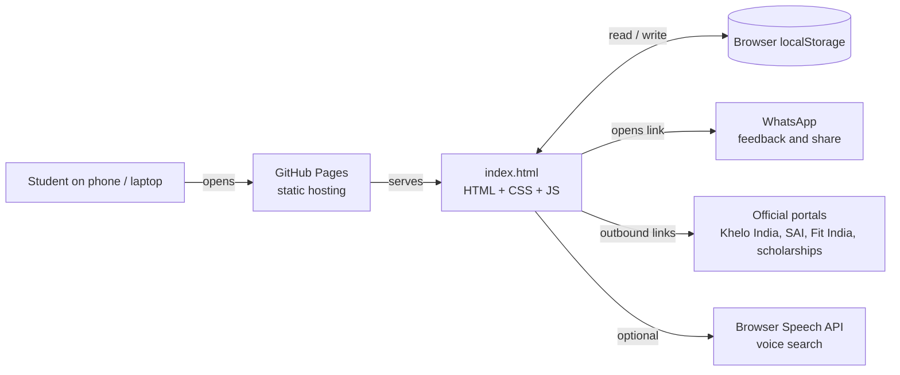
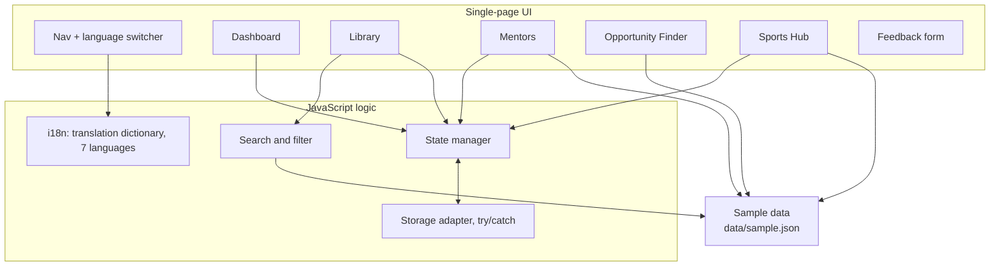
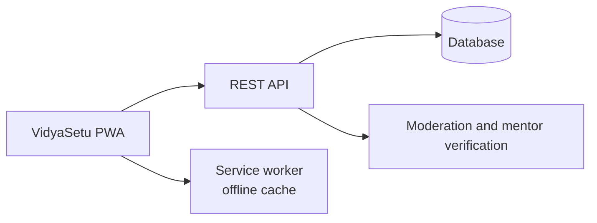

# VidyaSetu – Technical Design Document

## 1. Goals and constraints

- Work for rural students: low-end phones, slow or patchy internet, regional languages.
- Zero cost to host and zero accounts to create.
- Privacy by default: no personal data leaves the device.

These constraints led to a **static, client-only architecture**.

## 2. System context

## 3. Application components

## 4. Data flows

**Search and save a resource**
1. The student types (or speaks) a query and picks a level.
2. The search filter runs over the resource list in memory.
3. Tapping ★ writes the resource id to localStorage.
4. The dashboard counters refresh from state.

**Sports checklist**
1. The student picks a sport and a stage.
2. The app builds a starter checklist from the sample data.
3. The checklist is saved in localStorage and shown on the dashboard.

**Feedback**
1. The student fills in role, most useful part and comments.
2. The app builds a `wa.me` link with the message pre-filled.
3. The student sends it from WhatsApp. Nothing is stored by the app.

## 5. Data model (`data/sample.json`)

| Collection | Key fields |
|---|---|
| `library` | `id`, `title`, `level` (school/college/competitive), `language`, `subject`, `description` |
| `mentors` | `id`, `name`, `field`, `level`, `languages`, `bio` (all fictional samples) |
| `opportunities` | `id`, `name`, `category`, `official_url`, `audience` |
| `sports` | `sport`, `stages[]` with `checklist[]` |

Saved items, user-added resources, the sports checklist and the chosen language are kept in localStorage on the student's device.

## 6. Design decisions

| Decision | Reason |
|---|---|
| Static single-file app | Free hosting, no build step, easy for students to fork |
| localStorage instead of a database | No login, no server, privacy by default |
| WhatsApp for feedback and share | Most students already use it; no backend |
| Official-portal links only | Avoids spreading wrong or scam scholarship information |
| Language dictionary in the client | Language switches instantly with no extra network calls |

## 7. Security and privacy

- No backend, so no server-side attack surface and no stored personal data.
- User-entered text must be escaped before it is inserted into the page, to prevent XSS.
- External links should use `rel="noopener noreferrer"`.
- Storage reads and writes are wrapped in try/catch because storage can be blocked.

## 8. Limitations and future architecture

Shared libraries and verified mentors need a backend. The planned shape is below.

